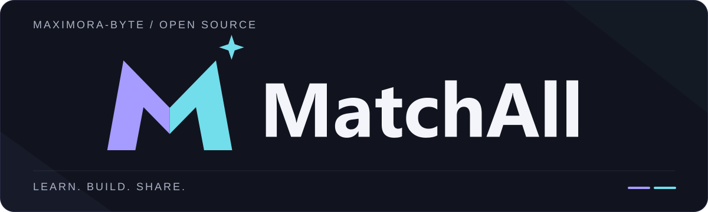

  

<h1 align="center">你好，我是 MatchAll · Hi, I'm MatchAll</h1>

  <b>C/C++ 学习 · ICPC 练习 · 校园工具 · 开源实践</b> 
  <b>Learning C/C++ · ICPC Practice · Campus Tools · Open-Source Projects</b> 
  在代码中学习，一次做好一个项目。 Learning through code, one project at a time. 
  学习 · 构建 · 分享 / Learn. Build. Share.

  <a href="#about">关于我 / About</a> ·
  <a href="#projects">精选项目 / Projects</a> ·
  <a href="#connect">交流与共建 / Connect & Contribute</a>

## 🌱 关于我 / About

这里记录我的 C/C++ 学习、课程练习，以及围绕校园场景的开源工具实践。  
This is where I share my C/C++ learning, coursework, and open-source tools built around campus needs.

- **学习 / Learn**：从 C/C++ 基础开始，整理 ICPC 练习、题目索引与易错点。  
  Starting with C/C++ fundamentals, I organize ICPC exercises, problem indexes, and common pitfalls.
- **实践 / Build**：把校园里的具体问题，拆成可以实现、验证和改进的小工具。  
  I turn practical campus problems into small tools that can be built, tested, and improved.
- **分享 / Share**：整理代码与文档，也在已有开源项目的基础上继续维护和改进。  
  I share code and documentation, and maintain and improve projects built on existing open-source work.

## ✦ 精选项目 / Selected Projects

### 🚌 [SWU Go](https://github.com/Maximora-byte/swu-busmini)

校园校车导航微信小程序，围绕线路、方向、站序与换乘查询展开。  
A WeChat Mini Program for campus shuttle navigation, covering routes, directions, stop sequences, and transfers.

**TypeScript · 微信小程序 / WeChat Mini Program · 开发中 / In development**  
线路与站点坐标仍在核验，当前展示不代表实时车辆信息。  
Route and stop coordinates are still being verified. The current display does not represent real-time vehicle information.

### 🛠️ [SWU Checkin](https://github.com/Maximora-byte/swu-checkin)

独立维护的非官方校园工具，包含 Python CLI、桌面端与 Android 客户端。  
An independently maintained, unofficial campus tool with a Python CLI, desktop client, and Android client.

**Python · 多平台客户端 / Cross-platform clients · 独立维护 fork / Independently maintained fork**  
源自 [Sorynthia/swu-checkin](https://github.com/Sorynthia/swu-checkin)，保留上游署名与 MIT 许可证。使用范围与各平台状态见项目文档。  
Based on [Sorynthia/swu-checkin](https://github.com/Sorynthia/swu-checkin), with upstream attribution and the MIT license preserved. See the project documentation for intended use and the status of each platform.

### 🧩 [ICPC Practice](https://github.com/Maximora-byte/icpctest)

C++ 基础练习与 ICPC 学习记录，按知识点整理题目、思路和易错点。  
C++ fundamentals and ICPC learning notes, with problems, approaches, and common pitfalls organized by topic.

**C++17 · 基础练习 / Fundamentals · 学习记录 / Learning notes**

### 📚 [SWU Homework](https://github.com/Maximora-byte/swu-homework)

C/C++ 课程练习与学习交流，按课程和主题整理，方便阅读、讨论与勘误。  
C/C++ coursework and study discussions, organized by course and topic for easy reading, discussion, and corrections.

**C / C++ · 课程练习 / Coursework · 学习互助 / Peer learning**

## ↗ 交流与共建 / Connect & Contribute

欢迎在对应项目的 Issues 中交流问题、思路和改进建议；代码与文档改进也可以通过 Pull Request 一起完善。  
Questions, ideas, and suggestions are welcome in each project's Issues. You can also contribute improvements to code and documentation through Pull Requests.

关于这个主页的设计 / About this profile's design

参考 [awesome-github-profile-readme](https://github.com/abhisheknaiidu/awesome-github-profile-readme) 的简洁导航、[github-profile-readme-generator](https://github.com/rahuldkjain/github-profile-readme-generator) 的信息分区，以及 [capsule-render](https://github.com/kyechan99/capsule-render) 的横幅层级。  
The layout takes inspiration from the simple navigation in [awesome-github-profile-readme](https://github.com/abhisheknaiidu/awesome-github-profile-readme), the content sections in [github-profile-readme-generator](https://github.com/rahuldkjain/github-profile-readme-generator), and the banner hierarchy in [capsule-render](https://github.com/kyechan99/capsule-render).

页眉使用 [MatchAll 原始品牌矢量](./assets/matchall-logo-dark.svg)，保留标志轮廓、颜色与比例；背景与版式沿用蓝紫、冰青与深墨色。静态资源保存在本仓库。  
The header uses the [original MatchAll brand vector](./assets/matchall-logo-dark.svg), preserving its shape, colors, and proportions. The background and layout use periwinkle, ice cyan, and ink-dark tones. Static assets are stored in this repository.

上述开源项目仅作布局参考，未复制其代码、字体或图形资产。正文使用 GitHub 原生 Markdown，不依赖外部统计或访问计数服务。  
These open-source projects are layout references only; their code, fonts, and graphic assets were not copied. The profile uses native GitHub Markdown and does not depend on external statistics or visitor-count services.

